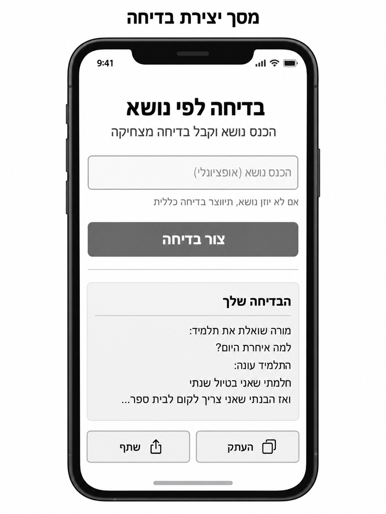
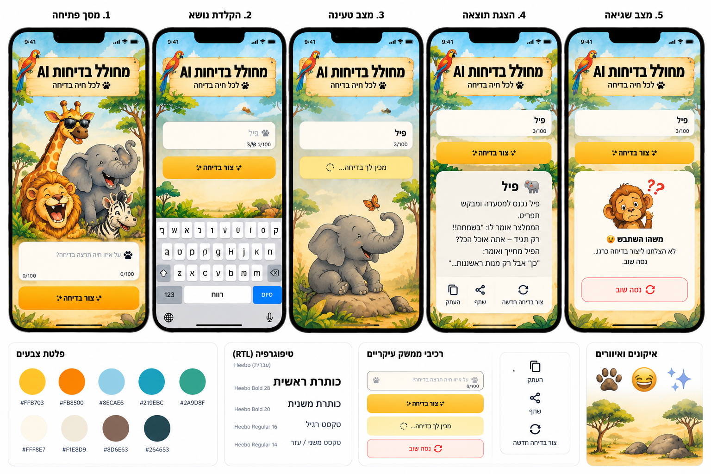
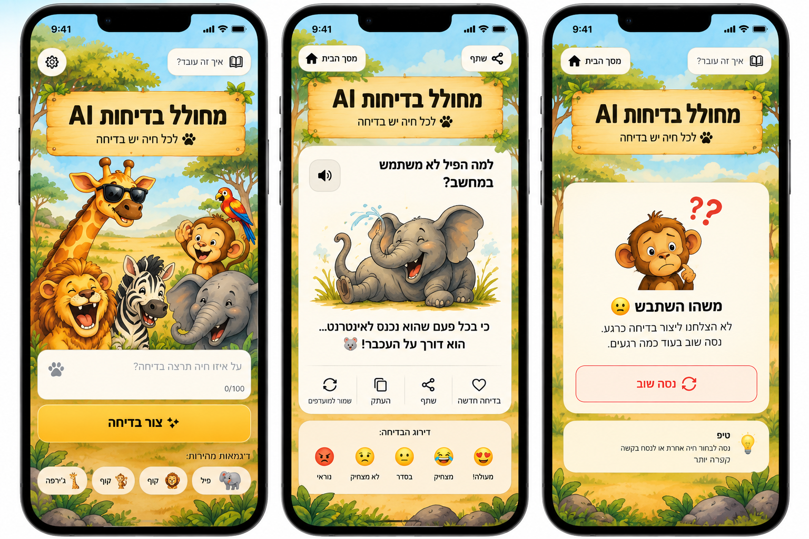

# DESIGN – מחולל בדיחות AI

## 1. Screens – מסכי האפליקציה

### מסך יצירת בדיחה

#### מטרת המסך
לאפשר למשתמש להזין נושא חופשי ולקבל בדיחה שנוצרה באמצעות AI, או לקבל בדיחה כללית כאשר לא הוזן נושא. כל חוויית השימוש המרכזית מתרחשת במסך יחיד.

#### מבנה ותוכן

המסך בנוי כ־Mobile-first layout אנכי, בכיווניות RTL מלאה.

הרכיבים המרכזיים:

1. **Header / Hero**
   - כותרת ראשית: **„מחולל בדיחות AI“**
   - טקסט משני קצר המסביר את הפעולה, לדוגמה: **„הכנס נושא וקבל בדיחה מצחיקה“**
   - אזור זה משמש גם כעוגן החזותי המרכזי של המסך.

2. **שדה הזנת נושא**
   - שדה טקסט רחב, מיושר לימין.
   - Placeholder: **„הכנס נושא (אופציונלי)“**
   - ניתן להשאיר את השדה ריק.
   - טקסט עזר מסביר כי במקרה כזה תיווצר בדיחה כללית.

3. **כפתור פעולה ראשי**
   - כפתור רחב ובולט: **„צור בדיחה“**
   - ממוקם מיד מתחת לשדה הקלט.
   - משמש כ־Primary CTA של המסך.

4. **אזור תוצאה**
   - מוצג באותו מסך, מתחת לכפתור הראשי.
   - כותרת: **„הבדיחה שלך“**
   - מתחת לכותרת מוצג טקסט הבדיחה.
   - הבדיחה מוצגת בתוך Card ברור ונפרד מבחינה חזותית.

5. **פעולות על הבדיחה**
   - **„העתק“**
   - **„שתף“**
   - שתי הפעולות מוצגות מתחת לטקסט הבדיחה ככפתורי Secondary Action.

#### מצבי המסך

המצבים הבאים הם מצבים של אותו מסך ולא מסכים נפרדים:

- **Initial State** – שדה הקלט זמין, טרם נוצרה בדיחה.
- **Loading State** – לאחר שליחת הבקשה מוצג חיווי ברור, לדוגמה: **„מכין לך בדיחה...“**.
- **Result State** – אזור התוצאה מציג את הבדיחה יחד עם כפתורי ההעתקה והשיתוף.
- **Error State** – מוצגת הודעה כגון **„משהו השתבש, נסה שוב“** וכפתור ניסיון חוזר.

#### פעולות וניווט

אין ניווט בין מסכים שונים.

זרימת השימוש המרכזית:

1. המשתמש מזין נושא או משאיר את השדה ריק.
2. המשתמש לוחץ על **„צור בדיחה“**.
3. מוצג מצב טעינה.
4. הבדיחה מוצגת באזור התוצאה באותו המסך.
5. המשתמש יכול להעתיק או לשתף את הבדיחה.
6. המשתמש יכול להזין נושא אחר וליצור בדיחה חדשה.

#### מבנה הניווט הכללי

האפליקציה היא Single-Screen Application מבחינת חוויית המשתמש. אין תפריט ניווט, Tabs או מעבר בין עמודים. כל המצבים והפעולות מתבצעים בתוך אותו View.

---

## 2. Style Guide – השפה העיצובית

### Color Palette

השפה החזותית מבוססת על Inspiration Board בסגנון ספארי חם, רך ואיורי.

צבעים מרכזיים:

| שימוש | צבע | HEX |
|---|---|---|
| Primary / CTA | כתום-צהוב חם | `#FFB703` |
| Accent Orange | כתום | `#FB8500` |
| Accent Purple | סגול עמוק | `#7A3B6F` |
| Soft Blue | כחול-מים בהיר | `#BFDDE0` |
| Peach | ורוד-אפרסק | `#F4A7A0` |
| Warm Sand | חול חם | `#EADCC8` |
| Olive Green | ירוק זית | `#6B8F5B` |
| Light Green | ירוק בהיר | `#A7C957` |
| Main Background | קרם בהיר | `#FFFDF8` |
| Main Text | חום כהה | `#3E2F2A` |
| Secondary Text | אפור-חום | `#6B625D` |

הצבעים החמים משמשים לפעולות ולנקודות תשומת לב, בעוד צבעי הקרם, החול והירוק משמשים לרקע ולאווירה.

### Typography

מומלץ להשתמש בגופן עברי נקי ומודרני המתאים לממשק Mobile, כגון:

- **Heebo**
- **Assistant**
- או system sans-serif תואם עברית.

היררכיה מומלצת:

- **כותרת ראשית:** 30–34px, Bold
- **כותרת אזור / Card:** 22–26px, Bold
- **טקסט גוף / בדיחה:** 18–22px, Regular
- **טקסט עזר:** 14–18px, Regular
- **כפתורים:** 20–24px, Semi-Bold / Bold

כל הטקסטים בעברית מוצגים בכיווניות RTL וביישור לימין, למעט רכיבים שבהם יישור מרכזי מתאים פונקציונלית, כגון CTA.

### UI Style

#### כפתורים
- פינות מעוגלות באופן בולט.
- Primary CTA בצבע חם ובולט.
- רוחב גדול המתאים לשימוש באצבע במובייל.
- טקסט ברור וקצר.
- Secondary Actions משתמשים ברקע בהיר עם Border בצבע Accent.

#### שדות קלט
- רקע בהיר.
- Border עדין.
- פינות מעוגלות.
- Placeholder מיושר לימין.
- Padding פנימי נדיב.
- גובה שמאפשר Tap נוח.

#### Cards
- רקע קרם או לבן חם.
- פינות מעוגלות.
- Shadow עדין מאוד.
- Padding רחב.
- הבחנה ברורה בין אזור הקלט לאזור התוצאה.

#### אייקונים
- אייקונים פשוטים, ידידותיים וברורים.
- סגנון עקבי ורך.
- שימוש מתון באייקונים סביב פעולות כמו העתקה ושיתוף.

### Visual Style

העיצוב שואב השראה מעולם ספארי מאויר:

- רקעים בגווני שמיים, קרם וחול.
- צמחייה ואיורים רכים בסגנון watercolor.
- שימוש בדמויות או מוטיבים של חיות באופן דקורטיבי.
- צבעוניות חמה, ידידותית ולא טכנית.
- פינות מעוגלות.
- קווי מתאר עדינים.
- Shadows רכים.
- הרבה whitespace סביב רכיבים מרכזיים.

האיורים משמשים ליצירת אווירה, אך אינם מחליפים או מסתירים רכיבי UI פונקציונליים.

### Spacing

מערכת מרווחים מומלצת:

- `8px` – רווח קטן בין אייקון לטקסט.
- `16px` – רווח בין רכיבים קשורים.
- `24px` – רווח בין קבוצות UI.
- `32px` – הפרדה בין אזורים עיקריים.

יש לשמור על Padding פנימי נדיב ב־Cards ובכפתורים, כדי שהמסך ירגיש אוורירי ולא צפוף.

### Layout

- Mobile-only.
- מבנה אנכי.
- רוחב התוכן כמעט מלא, עם margins צדדיים עקביים.
- CTA ראשי רחב.
- אזור התוצאה מופיע ישירות מתחת לאזור יצירת הבדיחה.
- אין Navigation Bar או Tabs.
- יש להימנע מהעמסת רכיבים שאינם נדרשים.

### שפה וכיווניות

- שפת הממשק: עברית.
- כיווניות: **RTL מלאה**.
- `dir="rtl"` ברמת המסמך / האפליקציה.
- שדות טקסט בעברית: `text-align: right`.
- כותרות, Placeholder, הודעות שגיאה וטקסטי עזר: יישור לימין.
- כפתורים מרכזיים יכולים להיות מיושרים למרכז מבחינת הטקסט, אך סדר הרכיבים והפריסה נשמרים לפי RTL.
- אין להפוך ידנית את סדר האותיות בטקסט עברי; יש להסתמך על מנגנון RTL תקני של הדפדפן.

---

## תמונות מקור

### Wireframes

### Style Guide

### Mockups

